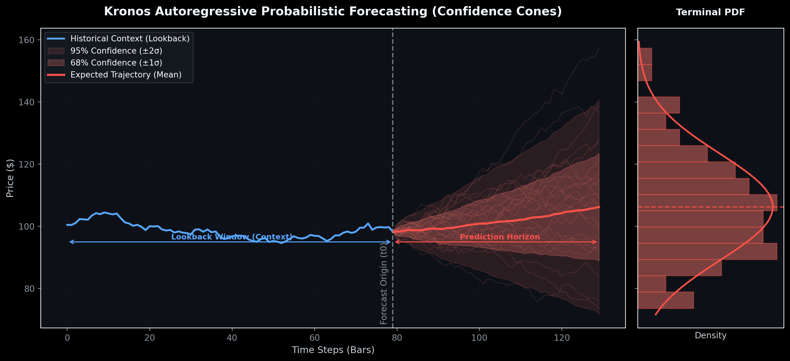

# Kronos: Foundation Model for the Language of Financial Markets

<div align="center">

[](https://huggingface.co/NeoQuasar)
[](LICENSE)
[](https://www.python.org/)
[](https://arxiv.org/abs/2508.02739)
[](https://arxiv.org/abs/2508.02739)

<p align="center">
  
</p>

<h3><b>The First Open-Source Foundation Model for Financial Candlesticks (K-Lines)</b></h3>
<p>Pre-trained on historical market data across <b>45+ global exchanges</b>.</p>

</div>

---

## 📖 Table of Contents
1. [What is Kronos? (Beginner Intuition)](#-what-is-kronos-beginner-intuition)
2. [What Data Was Kronos Trained On?](#-what-data-was-kronos-trained-on)
3. [What Does Kronos Provide?](#-what-does-kronos-provide)
   - [1. Direct Candlestick Price Trajectories](#1-direct-candlestick-price-trajectories)
   - [2. Probabilistic Sampling & Confidence Bands (Gaussian / Fan Curves)](#2-probabilistic-sampling--confidence-bands-gaussian--fan-curves)
   - [3. Dual Volume & Liquidity Forecasting](#3-dual-volume--liquidity-forecasting)
   - [4. Hierarchical Discrete Tokenizer (Noise Reduction)](#4-hierarchical-discrete-tokenizer-noise-reduction)
4. [Key Use Cases](#-key-use-cases)
5. [Model Zoo & Specifications](#-model-zoo--specifications)
6. [Quickstart Guide (Step-by-Step)](#-quickstart-guide-step-by-step)
   - [Installation](#installation)
   - [Single Asset Forecasting](#single-asset-forecasting)
   - [Batch Forecasting Multiple Symbols](#batch-forecasting-multiple-symbols)
   - [Generating Probabilistic Confidence Intervals](#generating-probabilistic-confidence-intervals)
7. [Visual Quant Studio & Web UI](#-visual-quant-studio--web-ui)
8. [Fetching Custom Market Data (Indian NSE, Crypto, US Equities)](#-fetching-custom-market-data)
9. [Fine-Tuning on Custom Data](#-fine-tuning-on-custom-data)
10. [FAQ & Troubleshooting](#-faq--troubleshooting)

---

## 🌟 What is Kronos? (Beginner Intuition)

If you are familiar with Large Language Models like **ChatGPT**:
- ChatGPT reads a sequence of words (tokens) and predicts the **next word** in a sentence.
- **Kronos is the GPT for Financial Markets.** It reads a sequence of historical market candlesticks (Open, High, Low, Close, Volume, Turnover) and autoregressively predicts the **next future candlesticks**.

### Why do standard Machine Learning models fail on financial data?
Traditional time-series models (ARIMA, LSTMs, simple Linear Networks, or generic Time-Series Transformers) usually struggle in finance because:
1. **Extremely Low Signal-to-Noise Ratio**: Microstructure noise and random order-flow chop confuse continuous regression models.
2. **Non-Stationarity & Regime Shifts**: Markets shift from calm bull runs to sudden flash crashes.
3. **Multi-Scale Correlations**: An asset's Open, High, Low, Close, and Volume are deeply coupled.

### How Kronos Solves This
Kronos employs a **two-stage foundation architecture**:
```
┌─────────────────────────────────┐      ┌───────────────────────────────┐      ┌───────────────────────────────┐
│ Continuous Financial K-Lines    │      │ Kronos Hierarchical Tokenizer │      │ Autoregressive Transformer    │
│ [Open, High, Low, Close, Vol]   │ ───► │ Quantizes continuous prices   │ ───► │ Predicts probability over     │
│ (Raw noisy market data)         │      │ into discrete semantic tokens │      │ next candlestick tokens       │
└─────────────────────────────────┘      └───────────────────────────────┘      └───────────────────────────────┘
                                                                                        │
                                                                                        ▼
                                                                        ┌───────────────────────────────┐
                                                                        │ De-quantization & Trajectory  │
                                                                        │ Future OHLCV + Probability    │
                                                                        └───────────────────────────────┘
```
1. **Hierarchical Tokenizer**: Converts continuous 6D candlestick vectors into discrete token pairs via Vector-Quantized (VQ) codebooks, effectively filtering out high-frequency noise.
2. **Autoregressive Transformer**: A decoder-only Transformer pre-trained at scale on millions of tokenized market sequences across global exchanges.

---

## 📊 What Data Was Kronos Trained On?

Kronos was pre-trained on a massive, heterogeneous corpus of financial candlestick data spanning:
- **45+ Global Financial Exchanges**:
  - **US Equities**: NYSE, NASDAQ (Apple, Microsoft, Tesla, S&P 500, etc.)
  - **Asian Markets**: Shanghai Stock Exchange (SSE), Shenzhen Stock Exchange (SZSE), Hong Kong (HKEX), Tokyo Stock Exchange (TSE), National Stock Exchange of India (NSE).
  - **European Markets**: LSE, Euronext, Deutsche Börse.
  - **Global Indices & Commodities**: S&P 500, Nasdaq 100, Nifty 50, Gold, Crude Oil, Treasury yields.
  - **Cryptocurrencies**: Major spot and perpetual pairs (BTC, ETH, SOL, etc.).
- **Multiple Timeframe Granularities**: 1-minute, 5-minute, 15-minute, 1-hour, and Daily (1D) bars.
- **Decades of Market Cycles**: Encompasses secular bull runs, bear markets, high-volatility flash crashes, and sideways chop.

---

## 🎯 What Does Kronos Provide?

### 1. Direct Candlestick Price Trajectories
Kronos provides complete future trajectories for all 6 core market fields:
- **`open`**: Projected opening price of each future bar.
- **`high`**: Expected maximum price reach (vital for setting stop-losses & take-profits).
- **`low`**: Expected minimum price dip.
- **`close`**: Projected settlement price.
- **`volume`**: Anticipated trading volume / liquidity.
- **`amount`**: Projected monetary turnover.

### 2. Probabilistic Sampling & Confidence Bands (Gaussian / Fan Curves)
Because Kronos outputs a **probability distribution** over discrete tokens at each step rather than a single deterministic number:
- You can sample multiple trajectory paths (`sample_count = 50` or `100`).
- By running Monte Carlo sampling with temperature $T$ and nucleus sampling $\text{top\_p}$, you get:
  - **Mean / Median expected path**.
  - **$\pm 1\sigma$ and $\pm 2\sigma$ standard deviation confidence cones**.
  - **Full Probability Density Function (PDF)** of expected future returns.
  - **Tail-risk & Value-at-Risk (VaR)** estimates.

<p align="center">
  
</p>

### 3. Dual Volume & Liquidity Forecasting
Markets are not just price—they are driven by order flow. Kronos predicts price and volume simultaneously. This reveals:
- **Volume Breakouts**: When price surges on predicted high volume (high conviction).
- **Exhaustion Moves**: When price drifts higher on predicted falling volume (reversal alert).

### 4. Hierarchical Discrete Tokenizer (Noise Reduction)
Financial data is notorious for heavy tails and non-Gaussian jumps. The Kronos tokenizer breaks down each candlestick into hierarchical codes:
- **High-order tokens**: Capture broad structural trend and macro regime.
- **Low-order tokens**: Capture fine-grained intra-bar price movement.

---

## 💡 Key Use Cases

| Use Case | Description |
| :--- | :--- |
| **Algorithmic Trading Signals** | Generate directional momentum, mean-reversion, and breakout signals for automated execution bots. |
| **Risk Management & VaR** | Simulate thousands of possible future price paths to calculate Value-at-Risk, Expected Shortfall, and max drawdown risks. |
| **Option Pricing & Volatility** | Derive implied forward volatility cones directly from probabilistic trajectory distributions. |
| **Optimal Order Execution (VWAP/TWAP)** | Use predicted volume curves to minimize market impact and slippage when executing large institutional orders. |
| **Foundation Feature Extractor** | Extract Kronos token embeddings as dense latent representations for downstream Reinforcement Learning or Machine Learning models. |

---

## 📦 Model Zoo & Specifications

All pre-trained checkpoints are hosted on the [Hugging Face Hub](https://huggingface.co/NeoQuasar):

| Model Checkpoint | Tokenizer | Context Window | Parameters | Recommended Hardware | Use Case |
| :--- | :--- | :---: | :---: | :---: | :--- |
| **Kronos-mini** | `Kronos-Tokenizer-2k` | **2048 bars** | **4.1M** | CPU or any GPU | Long historical lookback, fast lightweight inference |
| **Kronos-small** | `Kronos-Tokenizer-base` | **512 bars** | **24.7M** | Modern GPU / CPU | General quantitative research & live intraday trading |
| **Kronos-base** | `Kronos-Tokenizer-base` | **512 bars** | **102.3M** | High-end GPU | Highest capacity, complex cross-market regimes |

---

## 🚀 Quickstart Guide (Step-by-Step)

### Installation

1. **Clone the repository**:
   ```bash
   git clone https://github.com/dhruvkachhela/Kronos.git
   cd Kronos
   ```

2. **Create and activate a virtual environment (Python 3.10 or 3.11)**:
   ```bash
   python -m venv myenv
   # Windows:
   myenv\Scripts\activate
   # Linux/macOS:
   source myenv/bin/activate
   ```

3. **Install dependencies**:
   ```bash
   pip install -r requirements.txt
   ```

---

### Single Asset Forecasting

Predict the next 120 bars from historical candlestick data in just a few lines:

```python
import pandas as pd
from model import Kronos, KronosTokenizer, KronosPredictor

# 1. Load tokenizer and foundation model from Hugging Face
tokenizer = KronosTokenizer.from_pretrained("NeoQuasar/Kronos-Tokenizer-base")
model = Kronos.from_pretrained("NeoQuasar/Kronos-small")

# 2. Instantiate predictor
predictor = KronosPredictor(model, tokenizer, max_context=512)

# 3. Load historical candlestick data (OHLCV)
df = pd.read_csv("data/NSE_NIFTY50_5m.csv")
df['timestamps'] = pd.to_datetime(df['timestamps'])

lookback = 400   # Number of past bars to observe
pred_len = 120   # Number of future bars to predict

x_df = df.loc[:lookback-1, ['open', 'high', 'low', 'close', 'volume', 'amount']]
x_timestamp = df.loc[:lookback-1, 'timestamps']
y_timestamp = df.loc[lookback:lookback+pred_len-1, 'timestamps']

# 4. Generate future forecast trajectory
pred_df = predictor.predict(
    df=x_df,
    x_timestamp=x_timestamp,
    y_timestamp=y_timestamp,
    pred_len=pred_len,
    T=1.0,          # Temperature (lower = more deterministic, higher = more diverse)
    top_p=0.9,      # Nucleus sampling probability
    sample_count=1  # Number of paths to sample and average
)

print("Forecasted Candlesticks:")
print(pred_df.head())
```

---

### Batch Forecasting Multiple Symbols

Forecast multiple assets (e.g., BTC, ETH, Nifty 50, Reliance) in parallel on the GPU:

```python
# Pass lists of dataframes and timestamps
pred_df_list = predictor.predict_batch(
    df_list=[df_btc, df_eth, df_nifty],
    x_timestamp_list=[ts_btc, ts_eth, ts_nifty],
    y_timestamp_list=[future_btc, future_eth, future_nifty],
    pred_len=120,
    T=1.0,
    top_p=0.9,
    sample_count=1,
    verbose=True
)

for symbol, pred in zip(["BTC", "ETH", "NIFTY"], pred_df_list):
    print(f"--- {symbol} Forecast ---")
    print(pred[['open', 'high', 'low', 'close', 'volume']].head())
```

---

### Generating Probabilistic Confidence Intervals

Generate a full Gaussian-like probability distribution with $\pm 1\sigma$ and $\pm 2\sigma$ confidence intervals via Monte Carlo trajectory sampling:

```python
import numpy as np

# Sample 50 distinct paths
sampled_trajectories = []
for _ in range(50):
    sample = predictor.predict(
        df=x_df,
        x_timestamp=x_timestamp,
        y_timestamp=y_timestamp,
        pred_len=pred_len,
        T=1.0,
        top_p=0.95,
        sample_count=1
    )
    sampled_trajectories.append(sample['close'].values)

samples_arr = np.array(sampled_trajectories)  # Shape: (50, pred_len)

# Calculate distribution metrics
mean_path = np.mean(samples_arr, axis=0)
std_path  = np.std(samples_arr, axis=0)
upper_1sigma = mean_path + std_path
lower_1sigma = mean_path - std_path
upper_2sigma = mean_path + 2 * std_path
lower_2sigma = mean_path - 2 * std_path

print(f"Expected Close: {mean_path[-1]:.2f} ± {std_path[-1]:.2f}")
```

---

## 🖥️ Interactive Web Dashboards & Visual UIs

Kronos comes with **two interactive visual web interfaces** tailored for different workflows:
1. **Quant Studio (`quant_studio/app.py`)**: A streamlined, high-speed 2-panel evaluator with synchronized zooming, scorecards, and directional hit rate metrics.
2. **Official Full WebUI (`webui/app.py`)**: A comprehensive multi-model dashboard supporting candlestick (OHLC) charts, historical date range filtering, and tabular inspection.

---

### Option 1: Quant Studio (Fast Dual-Panel Evaluator & Scorecards)

Designed for rapid quantitative validation and visual backtesting against ground truth.

#### How to run:
```bash
python quant_studio/app.py
```
Open **`http://localhost:7080`** in your browser.

<p align="center">
  
</p>

#### What the Quant Studio Shows:
- **📊 2-Panel Synchronized Charts**:
  - **Top Panel (Close Price)**: Displays historical ground-truth context (Solid Blue line), future ground truth (Dotted Blue line), and the Kronos predicted trajectory (Solid Red line).
  - **Bottom Panel (Volume & Liquidity)**: Real-time trading volume predictions alongside actual historical volume.
  - **Synchronized Dual-Axis Mouse-Wheel Zoom & Pan**: Zooming or panning on either panel automatically locks and moves the second panel in exact temporal alignment.
- **🎯 Live Quantitative Performance Scorecards**:
  - **Directional Hit Rate (%)**: Percentage of future bars where Kronos correctly forecast the market direction (Up vs Down).
  - **MAE (Mean Absolute Error)**: Average numerical deviation between predicted prices and ground truth.
  - **RMSE (Root Mean Squared Error)**: Quadratic metric penalizing large forecast outliers.
- **⚡ 1-Click Multi-Market Dropdown**:
  - **Indian Stock Market (NSE)**: Nifty 50 (`^NSEI`), Bank Nifty (`^NSEBANK`), Reliance (`RELIANCE.NS`), TCS (`TCS.NS`), HDFC Bank (`HDFCBANK.NS`), Infosys (`INFY.NS`), SBI (`SBIN.NS`), ICICI Bank (`ICICIBANK.NS`).
  - **Crypto Assets**: Bitcoin (`BTC-USD`), Ethereum (`ETH-USD`), Solana (`SOL-USD`).
- **🎛️ Interactive Hyperparameter Sliders**:
  - **Lookback Window**: Number of past bars fed as context (e.g. 100 to 512 bars).
  - **Prediction Horizon**: Future bars to forecast (e.g. 24 to 120 bars).
  - **Temperature ($T$) & Top-$p$**: Control deterministic vs stochastic diversity in trajectory generation.
  - **Sample Count**: Number of Monte Carlo paths generated and averaged.

---

### Option 2: Official Full Kronos WebUI (Candlestick & Model Explorer)

The official full-featured web interface for in-depth model exploration and custom timeframe testing.

#### How to run:
```bash
python webui/app.py
```
Open **`http://localhost:7070`** in your browser.

#### What the Full WebUI Shows:
- **🕯️ Full Candlestick (OHLC K-Line) Visuals**: Renders full candlestick bars (green/red candles with wicks) comparing historical and predicted price structures.
- **🤖 Multi-Model Switcher**: Easily select and test different checkpoint sizes on the fly:
  - `Kronos-mini` (2048 context length)
  - `Kronos-small` (512 context length)
  - `Kronos-base` (102M parameters)
- **📅 Historical Date Range & Time-Window Picker**: Select specific historical dates, crisis events, or volatility regimes to evaluate how Kronos performs under specific market conditions.
- **📋 Numerical Tabular View**: Inspect exact forecasted numerical values for `Open`, `High`, `Low`, `Close`, `Volume`, and `Turnover` in an exportable table.

---

## 📥 Fetching Custom Market Data

Use the included helper script to download and prepare any global or Indian ticker:

```bash
# Fetch Indian NSE Equities / Indices
python data/fetch_indian_data.py ^NSEI          # Nifty 50 Index
python data/fetch_indian_data.py RELIANCE.NS     # Reliance Industries
python data/fetch_indian_data.py TATAMOTORS.NS   # Tata Motors

# Fetch Cryptocurrencies
python data/fetch_indian_data.py BTC-USD         # Bitcoin
python data/fetch_indian_data.py ETH-USD         # Ethereum
```

Downloaded datasets are automatically saved to `data/` formatted with required columns (`timestamps`, `open`, `high`, `low`, `close`, `volume`, `amount`).

---

## 🔧 Fine-Tuning on Custom Data

You can fine-tune both the Tokenizer and the Predictor on proprietary or exchange-specific datasets:

1. **Configure paths**: Edit `finetune/config.py`.
2. **Preprocess data**:
   ```bash
   python finetune/qlib_data_preprocess.py
   ```
3. **Fine-tune Tokenizer**:
   ```bash
   torchrun --standalone --nproc_per_node=1 finetune/train_tokenizer.py
   ```
4. **Fine-tune Predictor**:
   ```bash
   torchrun --standalone --nproc_per_node=1 finetune/train_predictor.py
   ```

---

## ❓ FAQ & Troubleshooting

#### Q: Why is volume flat on Index tickers (`^NSEI`, `^NSEBANK`)?
Spot indices do not have direct trading volume (only underlying derivative contracts do). Volume for spot indices is recorded as 0, so Kronos correctly predicts 0 volume. For active volume curves, use individual stocks (`RELIANCE.NS`, `TCS.NS`) or crypto pairs (`BTC-USD`).

#### Q: How does temperature `T` affect forecasts?
- **`T = 0.1 - 0.5`**: Low temperature. Predictions are conservative, smooth, and adhere strictly to dominant historical patterns.
- **`T = 1.0`**: Standard setting. Balances realism and market fluctuation.
- **`T = 1.5+`**: High temperature. Produces wider dispersion and captures extreme volatility scenarios.

---

## 📜 Citation & Acknowledgements

```bibtex
@article{kronos2025,
  title={Kronos: A Foundation Model for the Language of Financial Markets},
  author={Shiyu et al.},
  journal={arXiv preprint arXiv:2508.02739},
  year={2025}
}
```

---

## 📄 License
This project is licensed under the MIT License - see the [LICENSE](LICENSE) file for details.
